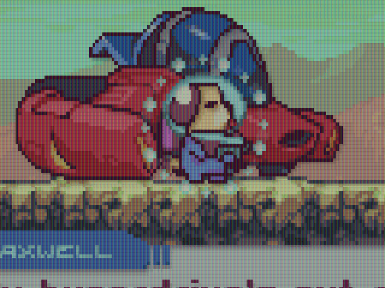
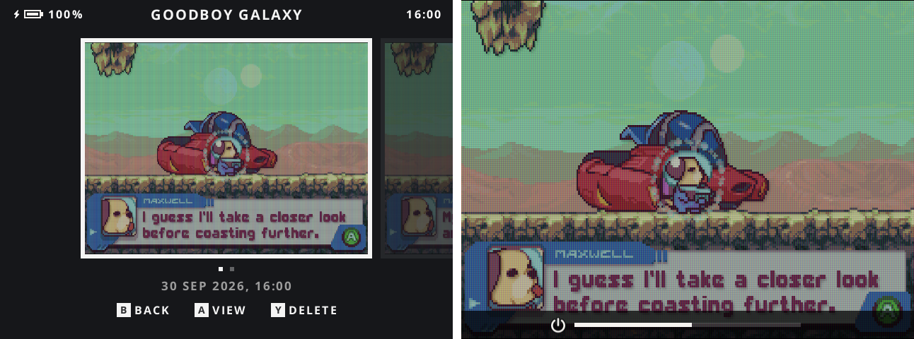
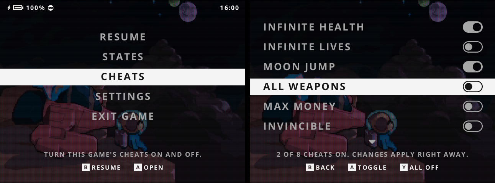
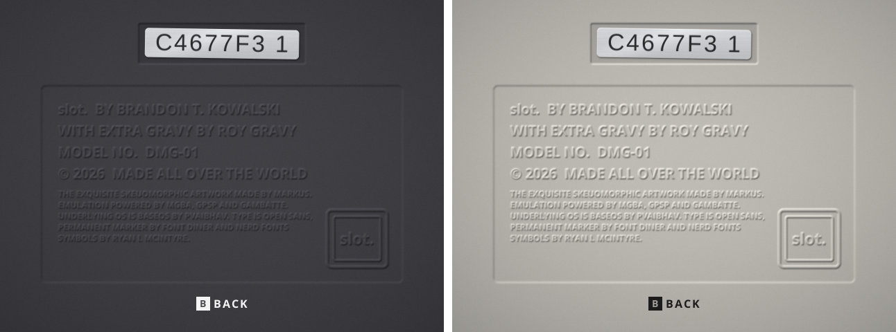
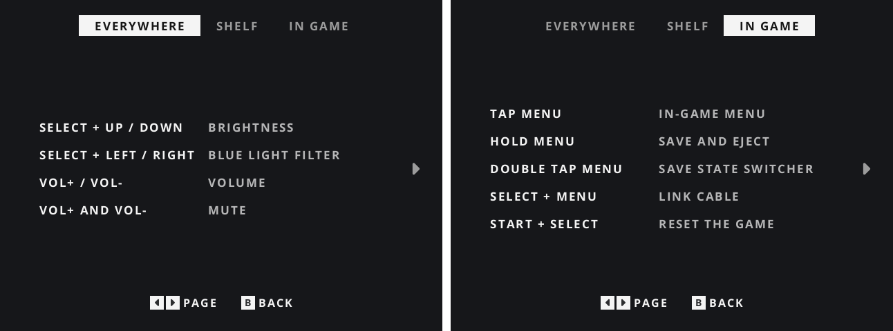

# slot. x GRAVY

**My own take on [slot.](https://github.com/BrandonKowalski/slot), Brandon Kowalski's Game Boy–centric frontend, for the Anbernic RG35XX Plus**

slot.'s real cartridges on a shelf and its real cartridge slot, with a little extra gravy on top.

[**Download slot-x-gravy-v1.0.2**](https://github.com/roygravy/slot/releases) · [Install](#install) · [What's in the gravy](#whats-in-the-gravy) · [Controls](#controls)

---

## What is slot. x GRAVY?

[slot.](https://github.com/BrandonKowalski/slot) is Brandon Kowalski's Game Boy frontend: a shelf of real cartridges, a real slot to push them into, save states, rewind, a link cable, Markus's lovely artwork, and a shelf that's there **3 to 5 seconds** after you power on. New to it? Start at **[slot-cfw.fyi](https://slot-cfw.fyi)**.

slot. x GRAVY is that, with my own gravy poured over it, made for the Anbernic RG35XX Plus. Same slot. underneath; a screen, a slot and a set of menus that feel a bit more like mine. It plays GB, GBC and GBA games (unzipped ROMs) on mGBA, gpSP and Gambatte.

---

## What's in the gravy

### A screen that looks like the real thing

This is the big one. Every console gets its own screen: the Game Boy's green dot matrix, the Game Boy Color's warm, slightly faded LCD with its fine RGB lines, and the Game Boy Advance in the same spirit. Pale pixels let the light through, every pixel casts a soft shadow, and moving pixels leave a faint trail, like an old LCD does.

Rather have it clean? **SELECT + B** turns it all off, and back on.

### A slot for every cartridge

Game Boy games go into a Game Boy slot, GBA games into a GBA SP slot, both redrawn in moulded plastic, down to the ribs on the back wall. Two new wallpapers come along, and either one goes with the Dark or the Light theme.

### Menus of their own

Quiet, monochrome menus: options on the left, values on the right, simple switches, and one plain line telling you what the selected option does. The light theme gets light menus. Every button and shortcut is on the **Buttons** pages.

### Every console, its own settings

Dot Matrix, palettes, Pixel Transparency, Ghosting and a Black Border, set per console, from the menu or right in the game. The Game Boy keeps to its own three palettes, DMG, Pocket and Light, or plays a game in its own Game Boy Color colours.

### Screenshots

**VOL+ and POWER** takes a screenshot, effects and all, in a game or in the menus. They wait for you on the Screenshots page.

### Cheats

Switch a game's cheats on and off while you play. The whole RetroArch cheat collection for GB, GBC and GBA is included, and your own `.cht` files work too. A little masked robber by the battery keeps you honest.

### Favorites in the spotlight

Star a cart with **Y** and it stands a little taller under a warm spotlight. Prefer a glow or a plain star? That's a setting.

### The back of a Game Boy

The About page is the back of the handheld, credits moulded into the plastic and a serial sticker stuck on slightly crooked.

### And a handful of smaller things

- Tap **POWER** to sleep; hold it and a bar counts down to power off
- **START + SELECT** resets the game
- **Resume Game** powers straight back into your game, its picture as the boot screen
- Carts without label art get their title written on by hand
- Native 640×480, with Game Boy and Game Boy Color games filling the screen; **L1 / R1** flips between full screen and original size
- Starts on your Favorites; GB, GBC, GBA in that order

---

## Install

1. Download **slot-x-gravy-v1.0.2.zip** from the [releases](https://github.com/roygravy/slot/releases).
2. Unzip it and copy the **contents** of the `slot-x-gravy-v1.0.2` folder onto the second SD card of your RG35XX Plus.
3. Put your games in `Games/GB`, `Games/GBC` and `Games/GBA`, and optional label art (PNG, named like the ROM) in the matching `Labels` folders.
4. Put the BIOS files (`gb_bios.bin`, `gbc_bios.bin`, `gba_bios.bin`) in `BIOS/` if you have them.

ROMs must be unzipped; `.zip` and `.7z` are not read.

---

## Controls

The full list is on the **Buttons** pages in the menu. The essentials:

| On the shelf | |
|---|---|
| Left / Right | Move along the shelf |
| L1 / R1 | Switch shelf |
| Tap A / Hold A | Play from your last save / start fresh |
| Y | Favorite |
| MENU | Settings |

| In a game | |
|---|---|
| Tap MENU | In-game menu |
| Hold MENU | Save and eject |
| SELECT + R1 / L1 | Save / load a state |
| Hold L2 / Hold R2 | Rewind / fast-forward |
| SELECT + B | Screen effects on / off |
| L1 / R1 | Full screen / original size (GB, GBC) |
| START + SELECT | Reset the game |

| Everywhere | |
|---|---|
| VOL+ and POWER | Screenshot |
| POWER / Hold POWER | Sleep / power off |
| SELECT + Up / Down | Brightness |

---

## Building

slot. x GRAVY builds the same way slot. does; see [the slot. README](SLOT_README.md) and `taskfile.yml`. The cartridge slots are drawn by `tools/slot_art.py`. Screenshots in this page were rendered headless with `cargo run --release -p slot --no-default-features --example shoot`.

---

## Credits

- **[slot.](https://github.com/BrandonKowalski/slot)** by Brandon Kowalski, with artwork by Markus and contributions from its community: everything slot. x GRAVY is built on, and most of what it does
- **mGBA**, **gpSP** and **Gambatte**, the emulator cores (their licenses and sources ship in `System/licenses`)
- **Permanent Marker** by Font Diner (Apache 2.0) for the handwritten titles
- **Liberation Sans** by Red Hat (SIL OFL 1.1), subset as "slot Serial", for the serial sticker on the About page
- The cheats from the **[libretro-database](https://github.com/libretro/libretro-database)** by the libretro team and contributors (CC BY-SA 4.0)
- **Goodboy Galaxy** (demo), **Hauntsfield** and **Mud Warriors**, the free games in the screenshots

Like slot., slot. x GRAVY was put together with help from Claude.

Licensed under the same terms as slot.; see [LICENSE](LICENSE).

---

## AI Disclosure

None of this is meant to be taken seriously. Every line of code I added, every pixel of the art I added and every word on this page was generated by Claude; I mostly pointed at things and said "a bit rounder" a lot. All the original art that isn't mine belongs to its respective makers.

I made slot. x GRAVY purely for myself, so that my device feels like *my* device. If you enjoy it too, that's a lovely bonus.

All the praise and credit goes to [Brandon](https://github.com/BrandonKowalski/slot) and the very special base he built. slot. is the whole meal; I'm just pouring a little of my own gravy over it.
