

**Real carts. Real slots. Real screens.** 
My own take on [slot.](https://github.com/BrandonKowalski/slot), designed for the Anbernic RG35XX Plus. Runs on every device slot. supports.

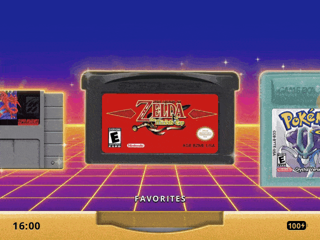

[**Download v1.3**](https://github.com/roygravy/slot/releases/latest) · [What it adds](#what-it-adds) · [Install](#install) · [Controls](#controls)

---

## What it adds

- **More consoles:** NES and SNES with their own carts, plus Super Game Boy
- **A slot for every console:** including realistic animations
- **Realistic screens:** from Dot Matrix to CRT, several screen sizes, easy to toggle; Sharp Pixels for perfectly even pixels
- **Game Boy palettes:** DMG, Pocket and Light
- **Cart and Slot Studio:** design your own cart and slot
- **RetroAchievements:** with in-game overviews
- **Cheats:** automatic download
- **Labels and cart colours:** downloaded automatically
- **Screenshots**
- **Favorites:** highlight with a special glow
- **The Deck:** a ready-to-play shelf
- **GRAVY Manager:** your browser for ROMs, screenshots, wallpapers and updates, including BaseOS
- **Full Wi-Fi:** auto time and in-game time
- **Bluetooth audio:** play through your wireless headphones or speaker
- **Deep Sleep**
- **Screen Calibration:** old-school style
- **Seamless Resume:** pick up after a shutdown
- **Animations and visuals:** a new animated shelf, the Game Boy power switch and a lot more
- **Button guides:** help pages for every screen

---

### NES, SNES and Super Game Boy

Two new shelves with carts in the real moulds, each with its own slot. Push the Super Game Boy into the SNES slot and the camera dives into the Game Boy shelf inside it.

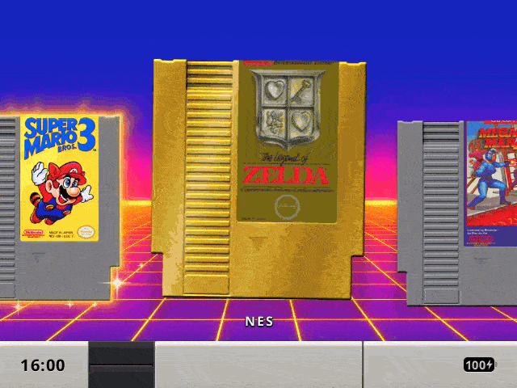

### A slot for every console

Game Boy, Game Boy Color, GBA SP, NES, SNES and Super Game Boy. Every cart slides in, clicks and powers up like the real thing.

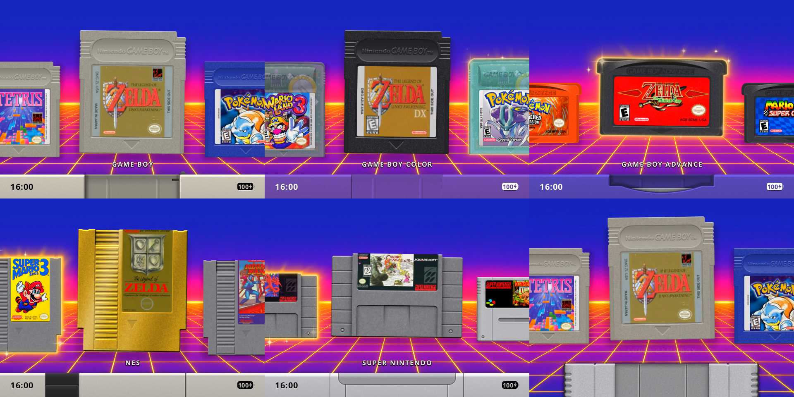

### Realistic screens

From the Game Boy's dot matrix to a living-room CRT. Pick a screen size per console and flip the effects off and on in game. Sharp Pixels keeps every pixel perfectly even.

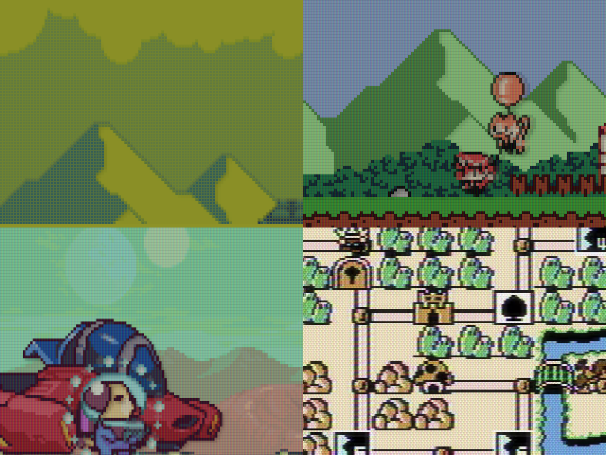

### Game Boy palettes

The three real Game Boy screens: DMG, Pocket and Light.

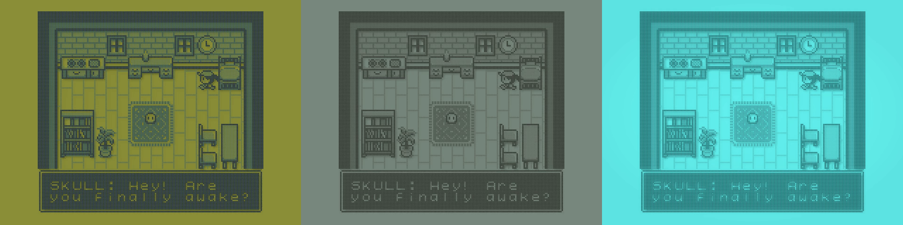

### Cart and Slot Studio

Design your own cart and slot. Shell colour, finish, label, and the colour of the slot it goes into.

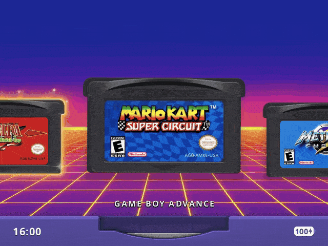

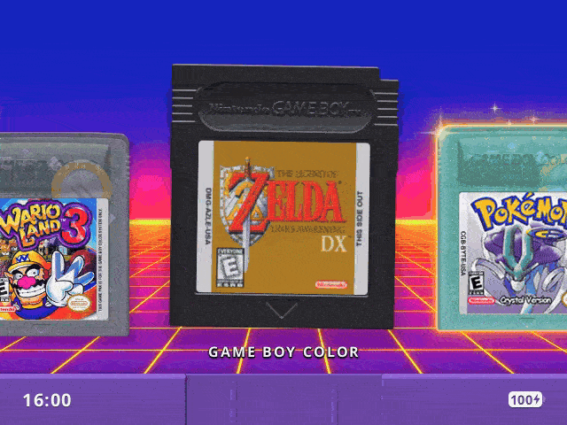

### RetroAchievements

Unlock achievements while you play and see your progress in the in-game menu.

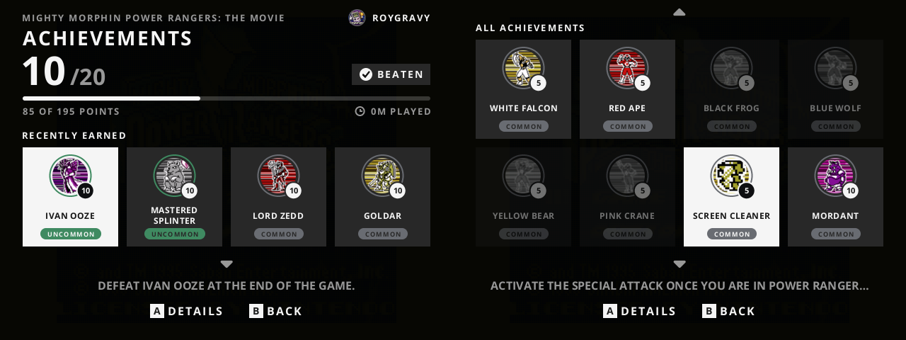

### Cheats, labels and cart colours

Connect to Wi-Fi and the rest comes by itself: cheats for your games, label art for your carts and the colour of the real cart.

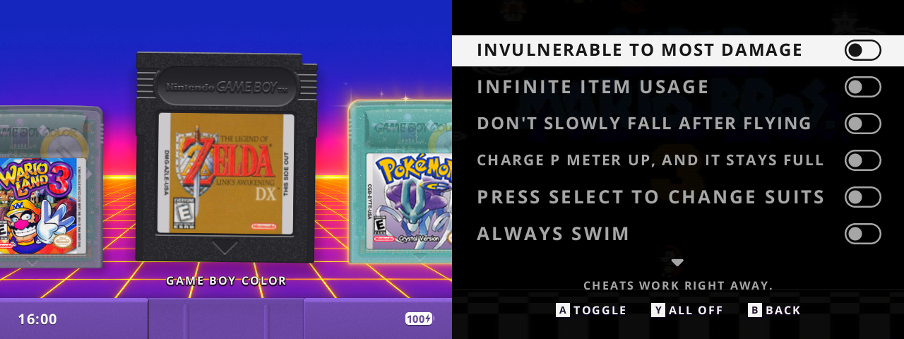

### Screenshots

**VOL+ and POWER** saves the screen, effects and all.

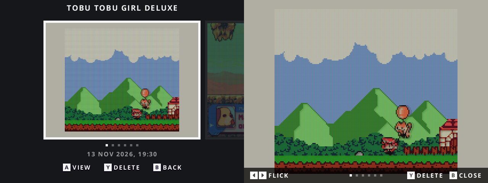

### The Deck, Favorites and Recents

Put the games you're playing now on The Deck, a shelf in its own spotlight. Star a cart and it lights up with a special glow. Recents keeps what you played last, faded like a memory.

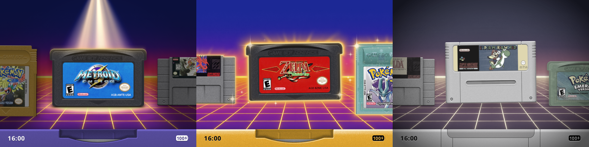

### GRAVY Manager

Your console in your browser. Add ROMs, grab your screenshots, change wallpapers and update slot. x GRAVY and BaseOS, from your phone, tablet or computer.

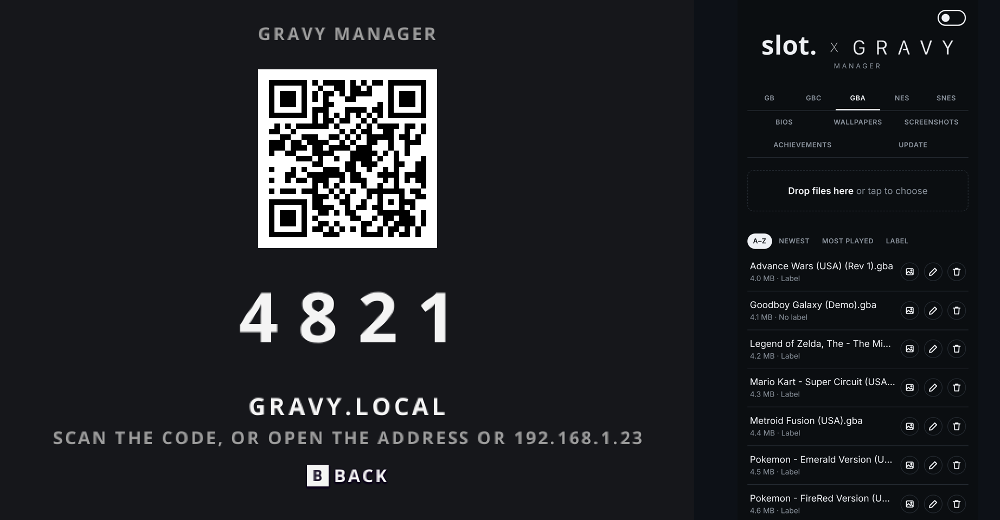

### Full Wi-Fi

Join your network from the menu. The clock sets itself, and games with a clock tell the right time.

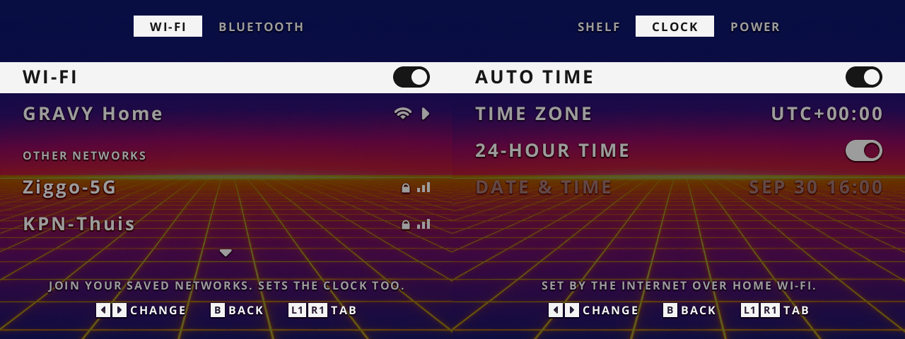

### Deep Sleep and Seamless Resume

Put your game to sleep for days. Switch off, switch on, and you're right back in your game.

### Screen Calibration

Tune your screen the old-school way, with a test card.

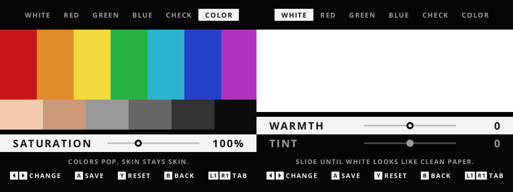

### Animations and visuals

A new animated shelf, the Game Boy power switch, springy menus and a lot more.

### Button guides

Every screen has its own help page with all buttons and shortcuts.

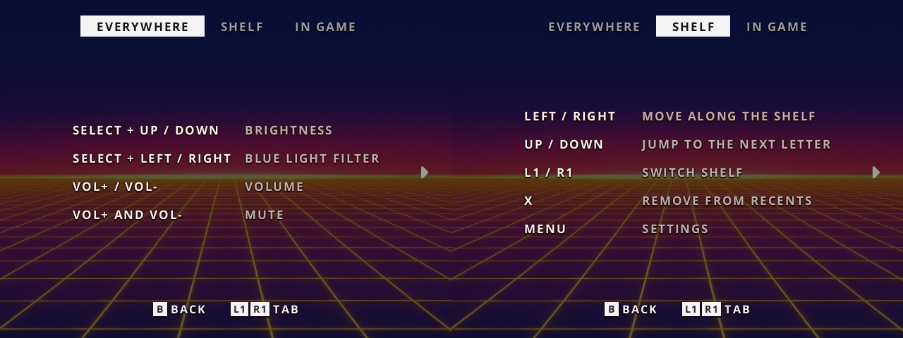

---

## Install

slot. x GRAVY runs on **BaseOS**, a small Linux that boots from the card in `SD1`. Pick one of two ways:

**One SD card**: everything on the card in `SD1`.

1. Write the latest [BaseOS](https://github.com/pvaibhav/BaseOS/releases/latest) `.img` to an SD card (with [Raspberry Pi Imager](https://www.raspberrypi.com/software/) or [Rufus](https://rufus.ie)) and put it in `SD1`.
2. Power on once. BaseOS expands the storage and then says no frontend was found. Power off.
3. Put the card back in your computer and copy the **contents** of the `slot-x-gravy-v1.3` folder from **[slot-x-gravy-v1.3.zip](https://github.com/roygravy/slot/releases/download/slot-x-gravy-v1.3/slot-x-gravy-v1.3.zip)** onto it.

**Two SD cards**: BaseOS in `SD1`, your games on a second card in `SD2`.

1. Write BaseOS to the first card as above and put it in `SD1`.
2. Format the second card as `FAT32` or `exFAT` (MBR) and copy the **contents** of the `slot-x-gravy-v1.3` folder onto it. Put it in `SD2`.

Then, on the card with slot. x GRAVY:

- Put your games in `Games/GB`, `Games/GBC`, `Games/GBA`, `Games/NES` and `Games/SNES`, and optional label art (PNG, named like the ROM) in the matching `Labels` folders.
- Put the BIOS files (`gb_bios.bin`, `gbc_bios.bin`, `gba_bios.bin`) in `BIOS/` if you have them. For the real Super Game Boy borders, put your own `SGB1.sfc` and/or `SGB2.sfc` in `BIOS/` too (any name works).

ROMs must be unzipped; `.zip` and `.7z` are not read.

Coming from v1.1.1 or older? Copy this version onto the card once. From v1.2 on, **GRAVY Manager** installs new versions over Wi-Fi.

---

## Controls

Every screen has its own **Buttons** page. The essentials:

| On the shelf | |
|---|---|
| Left / Right | Move along the shelf |
| L1 / R1 | Switch shelf |
| Tap A / Hold A | Play from your last save / start fresh |
| Y | Favorite |
| B | Put a cart on The Deck |
| SELECT | Cart and Slot Studio |
| MENU | Settings |

| In a game | |
|---|---|
| Tap MENU | In-game menu |
| Hold MENU | Save and eject |
| SELECT + R1 / L1 | Save / load a state |
| Hold L2 / Hold R2 | Rewind / fast-forward |
| SELECT + B | Screen effects on / off |
| L1 / R1 | Screen size (GB, GBC) |
| START + SELECT | Reset the game |

| Everywhere | |
|---|---|
| VOL+ and POWER | Screenshot |
| POWER / Hold POWER | Sleep / power off |
| SELECT + Up / Down | Brightness |

---

## Credits

- **[slot.](https://github.com/BrandonKowalski/slot)** by Brandon Kowalski, with artwork by Markus and contributions from its community: everything slot. x GRAVY is built on, and most of what it does. Fixes from slot. are taken over up to its v1.12
- **mGBA**, **gpSP**, **Gambatte**, **FCEUmm** and **Snes9x**, the emulator cores (their licenses and sources ship in `System/licenses`)
- **Permanent Marker** by Font Diner (Apache 2.0) for the handwritten titles
- **Liberation Sans** by Red Hat (SIL OFL 1.1), subset as "slot Serial", for the serial sticker on the About page
- The CRT shaders and Blargg's NTSC filter from the **[libretro](https://github.com/libretro)** shader collections
- **[RetroAchievements](https://retroachievements.org)** for the achievements
- Cart labels and colours from community game databases
- The cheats from the **[libretro-database](https://github.com/libretro/libretro-database)** by the libretro team and contributors (CC BY-SA 4.0)
- **Home Wi-Fi**, the label scraping and linking over the home network come from **[Prashant Vaibhav's fork](https://github.com/pvaibhav/slot)** of slot.
- **Goodboy Galaxy** (demo), **Hauntsfield** and **Mud Warriors**, the free games in the screenshots

Like slot., slot. x GRAVY was put together with help from Claude.

Licensed under the same terms as slot.; see [LICENSE](LICENSE).

---

## AI Disclosure

None of this is meant to be taken seriously. Every line of code I added, every pixel of the art I added and every word on this page was generated by Claude; I mostly pointed at things and said "a bit rounder" a lot. All the original art that isn't mine belongs to its respective makers.

I made slot. x GRAVY purely for myself, so that my device feels like *my* device. If you enjoy it too, that's a lovely bonus.

All the praise and credit goes to [Brandon](https://github.com/BrandonKowalski/slot) and the very special base he built. slot. is the whole meal; I'm just pouring a little of my own gravy over it.
