

# slot. x GRAVY

**My own take on [slot.](https://github.com/BrandonKowalski/slot), Brandon Kowalski's Game Boy–centric frontend, for the Anbernic RG35XX Plus (and 3:2 panels like the RG34XX SP)**

slot.'s real cartridges on a shelf and its real cartridge slot, with a little extra gravy on top.

[**Download slot-x-gravy-v1.2**](https://github.com/roygravy/slot/releases/download/slot-x-gravy-v1.2/slot-x-gravy-v1.2.zip) · [GRAVY Manager](#gravy-manager-your-card-from-your-phone) · [Install](#install) · [What's in the gravy](#whats-in-the-gravy) · [Controls](#controls)

---

## What is slot. x GRAVY?

[slot.](https://github.com/BrandonKowalski/slot) is Brandon Kowalski's Game Boy frontend: a shelf of real cartridges, a real slot to push them into, save states, rewind, a link cable, Markus's lovely artwork, and a shelf that's there **3 to 5 seconds** after you power on. New to it? Start at **[slot-cfw.fyi](https://slot-cfw.fyi)**.

slot. x GRAVY is that, with my own gravy poured over it, made for the Anbernic RG35XX Plus. Same slot. underneath; a screen, a slot and a set of menus that feel a bit more like mine. It plays GB, GBC, GBA, NES and SNES games (unzipped ROMs) on mGBA, gpSP, Gambatte, FCEUmm and Snes9x, and Game Boy games on a Super Game Boy.

---

## What's in the gravy

### A screen that looks like the real thing

This is the big one. Every console gets its own screen: the Game Boy's green dot matrix, the Game Boy Color's warm, slightly faded LCD with its fine RGB lines, and the Game Boy Advance in the same spirit. Pale pixels let the light through, every pixel casts a soft shadow, and moving pixels leave a faint trail, like an old LCD does.

Rather have it clean? **SELECT + B** turns it all off, and back on.

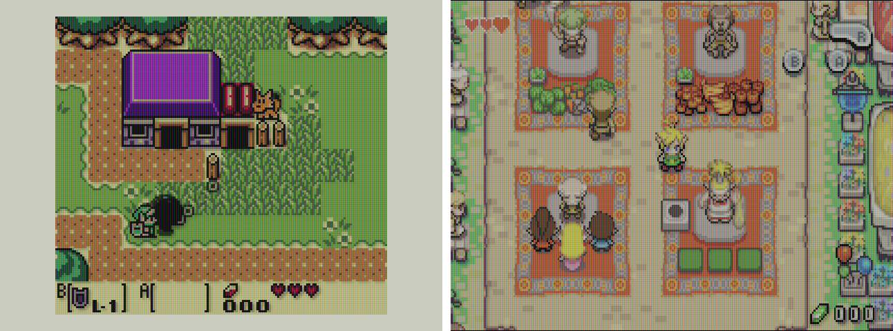

### GRAVY Manager: your card, from your phone

New in v1.2, and no more SD card shuffling. Pick **GRAVY Manager** under **Network** and the console shows a QR code, an address and a PIN. Scan it with your phone, or open the address on your computer, and the whole card is yours:

- **Games**: drop in ROMs for GB, GBC, GBA, NES and SNES, rename them or delete them. A renamed game keeps its saves, states, label, cart colour and its place in Favorites
- **BIOS and wallpapers**: add your BIOS files and your own wallpapers, with a preview
- **Screenshots**: everything you shot on the console, newest first, to look at and download
- **Update**: the console finds the newest slot. x GRAVY on GitHub, with what's new in it, or takes the zip you drop in. Nothing changes until you press **Install**, and if the new version does not start, the old one comes back by itself

Tick **Remember this phone** and that phone needs no PIN next time. The manager only listens while its screen is open on the console, and the console stays awake meanwhile.

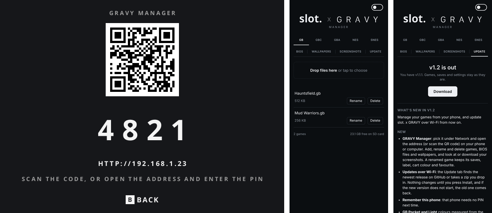

### A slot for every cartridge

Every console gets its own slot: Game Boy, Game Boy Color, GBA SP, NES, Super Nintendo and the Super Game Boy, redrawn in moulded plastic, down to the ribs on the back wall. Two new wallpapers come along, and either one goes with the Dark or the Light theme. The slot itself comes in Dark, Light or Originals, the colours of the real consoles.

### NES and SNES, on their own shelves

New in v1.1: an NES and a Super Nintendo shelf, each with its own slot, the NES with the two black blocks beside the lid of the real thing. Carts come in the NTSC and PAL moulds, and the picture goes through a CRT: an NES in Authentic or Trinitron colours, a Super Nintendo on a flat Trinitron, both through a composite signal.

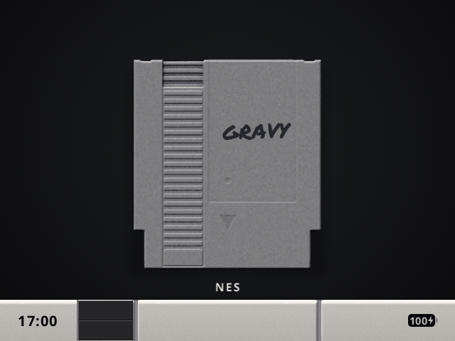

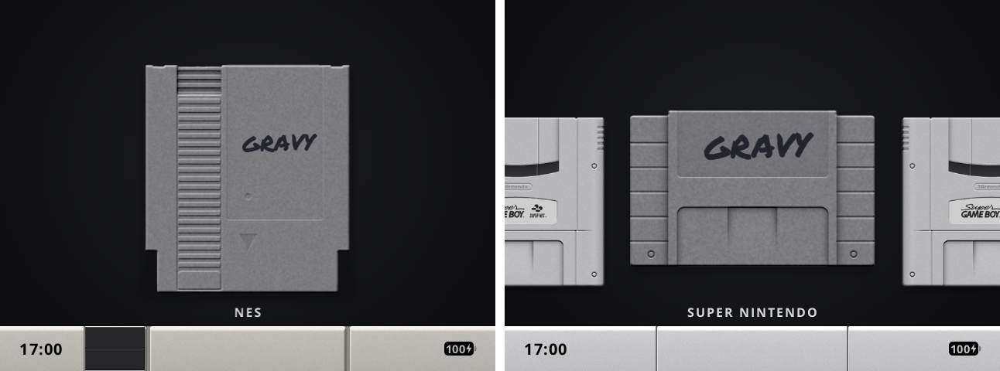

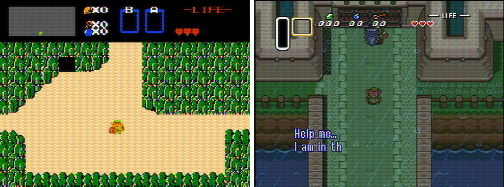

### A Super Game Boy

Put the Super Game Boy cart in the SNES slot and the camera zooms in onto the Game Boy shelf inside it. Game Boy games then play in their Super Game Boy colours with a border around them: the game's own, one of the eight real borders read from your `SGB1.sfc` or `SGB2.sfc`, or the slot. x GRAVY border.

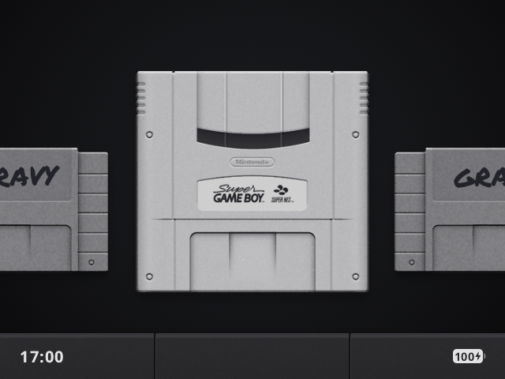

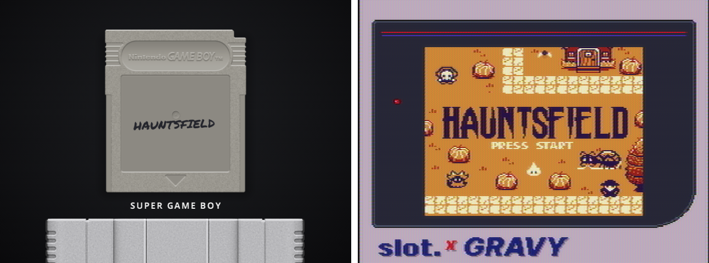

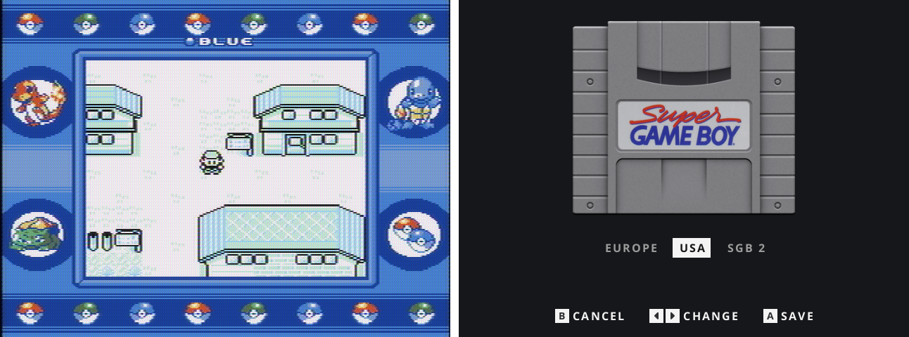

### A cartridge of your own

Press **SELECT** on a cart to open the cartridge studio: pick its shell colour and finish (solid, clear, glitter), fetch its label with **Y**, or give a blank cart a title in black, white or gold marker. Every system, NES and SNES included.

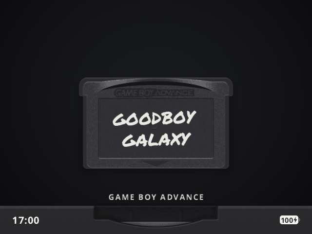

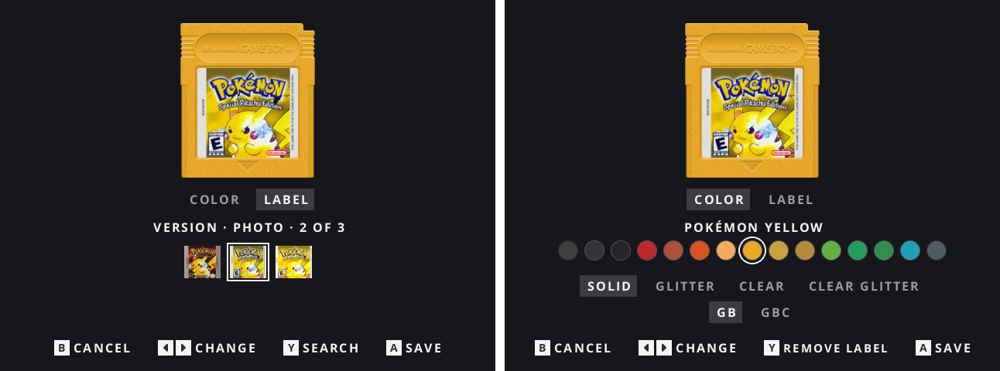

### Menus of their own

Quiet, monochrome menus: options on the left, values on the right, simple switches, and one plain line telling you what the selected option does. The light theme gets light menus. Every button and shortcut is on the **Buttons** pages.

### Every console, its own settings

Every console keeps its own screen settings, from the menu or right in the game: Dot Matrix, palettes, Pixel Transparency, Ghosting and a Black Border on the handhelds, a CRT and a screen cable on the NES and Super Nintendo. The Game Boy has its own three palettes, DMG, Pocket and Light, with the colours of the real handhelds, or plays a game in its own Game Boy Color colours.

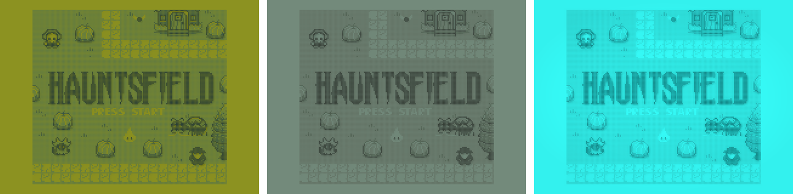

### Screenshots

**VOL+ and POWER** takes a screenshot, effects and all, in a game or in the menus. They wait for you on the Screenshots page.

### Cheats

Switch a game's cheats on and off while you play. The whole RetroArch cheat collection for GB, GBC and GBA is included, and your own `.cht` files work too. A little masked robber by the battery keeps you honest.

### Favorites in the spotlight

Star a cart with **Y** and it stands a little taller under a warm spotlight. Prefer a glow, a highlight behind the cart or a plain star? That's a setting. The light rests while you browse and comes up once the cart stands still.

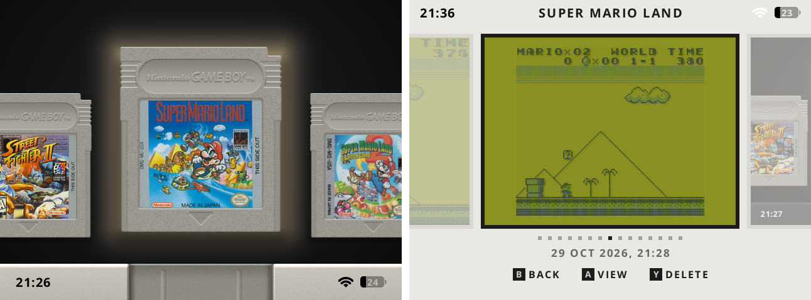

### Home Wi-Fi

Turn **Home Wi-Fi** on under **Network** in the menu and pick **Add Network** (or press your router's WPS button and pick **WPS**). You can also list networks in `Config/wifi.toml` (copy `wifi.toml.example`). From then on it works by itself:

- A phone-style status bar shows the clock, Wi-Fi and battery, and the clock sets itself (Auto Time, with your city's own summer time)
- Carts without label art get one in the background, found by the ROM's checksum or name; **Y** in the cartridge studio lets you search and pick another. No Wi-Fi? Put an `Artwork.pack` in `Labels/` and labels come from there. A label you added yourself is never replaced
- Each game gets its cheats from the libretro database
- Two handhelds at home link over your home network, no ad hoc network needed. Away from home the usual direct link still works

More in [network/README.md](network/README.md).

### Light sleep, deep sleep

Tap **POWER** and the console drops into a light sleep: Wi-Fi stays on and any button wakes it. After a few minutes (you pick: right away, 5, 10 or 30) it goes into a real deep sleep, suspended to RAM, that only POWER wakes, using about half a percent of battery an hour. Pick up right where you left off.

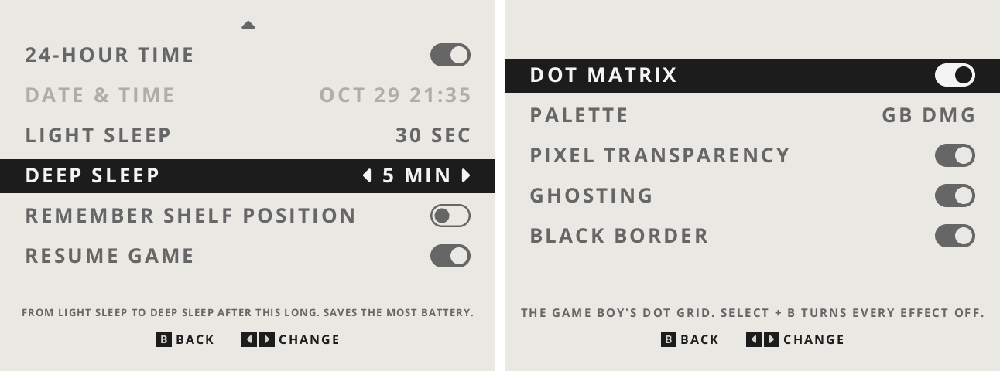

### And a handful of smaller things

- Hold **POWER** and a bar counts down to power off
- **START + SELECT** resets the game
- **Resume Game** powers straight back into your game, its picture as the boot screen
- Carts without label art get their title written on by hand
- **3:2 screens** too (RG34XX SP, 720×480): the shelf, menus, games, save states and screenshots fill the whole panel, no black bars
- Native 640×480, with Game Boy and Game Boy Color games filling the screen; **L1 / R1** step Game Boy and Game Boy Color games through three sizes: their own size, as tall as the screen, and full screen
- Starts on your Favorites; GB, GBC, GBA, NES, SNES in that order

---

## Install

1. Download **[slot-x-gravy-v1.2.zip](https://github.com/roygravy/slot/releases/download/slot-x-gravy-v1.2/slot-x-gravy-v1.2.zip)** from the [releases](https://github.com/roygravy/slot/releases/tag/slot-x-gravy-v1.2).
2. Unzip it and copy the **contents** of the `slot-x-gravy-v1.2` folder onto the second SD card of your RG35XX Plus.
3. Put your games in `Games/GB`, `Games/GBC`, `Games/GBA`, `Games/NES` and `Games/SNES`, and optional label art (PNG, named like the ROM) in the matching `Labels` folders.
4. Put the BIOS files (`gb_bios.bin`, `gbc_bios.bin`, `gba_bios.bin`) in `BIOS/` if you have them. For the real Super Game Boy borders, put your own `SGB1.sfc` and/or `SGB2.sfc` in `BIOS/` too (any name works).

ROMs must be unzipped; `.zip` and `.7z` are not read.

Coming from v1.1.1 or older? Copy v1.2 onto the card this once. From v1.2 on, **GRAVY Manager** installs new versions over Wi-Fi.

---

## Controls

The full list is on the **Buttons** pages in the menu. The essentials:

| On the shelf | |
|---|---|
| Left / Right | Move along the shelf |
| L1 / R1 | Switch shelf |
| Tap A / Hold A | Play from your last save / start fresh |
| Y | Favorite |
| MENU | Settings |

| In a game | |
|---|---|
| Tap MENU | In-game menu |
| Hold MENU | Save and eject |
| SELECT + R1 / L1 | Save / load a state |
| Hold L2 / Hold R2 | Rewind / fast-forward |
| SELECT + B | Screen effects on / off |
| L1 / R1 | Bigger / smaller picture (GB, GBC) |
| START + SELECT | Reset the game |

| Everywhere | |
|---|---|
| VOL+ and POWER | Screenshot |
| POWER / Hold POWER | Sleep / power off |
| Any button | Wake from light sleep |
| SELECT + Up / Down | Brightness |

---

## Building

slot. x GRAVY builds the same way slot. does; see `taskfile.yml`. The cartridge slots are drawn by `tools/slot_art.py`. Screenshots in this page were rendered headless with `cargo run --release -p slot --no-default-features --example shoot`.

---

## Credits

- **[slot.](https://github.com/BrandonKowalski/slot)** by Brandon Kowalski, with artwork by Markus and contributions from its community: everything slot. x GRAVY is built on, and most of what it does
- **mGBA**, **gpSP**, **Gambatte**, **FCEUmm** and **Snes9x**, the emulator cores (their licenses and sources ship in `System/licenses`)
- **Permanent Marker** by Font Diner (Apache 2.0) for the handwritten titles
- **Liberation Sans** by Red Hat (SIL OFL 1.1), subset as "slot Serial", for the serial sticker on the About page
- The CRT shaders and Blargg's NTSC filter from the **[libretro](https://github.com/libretro)** shader collections
- Cart labels from **LaunchBox**'s games database
- The cheats from the **[libretro-database](https://github.com/libretro/libretro-database)** by the libretro team and contributors (CC BY-SA 4.0)
- **Home Wi-Fi**, the label scraping and linking over the home network come from **[Prashant Vaibhav's fork](https://github.com/pvaibhav/slot)** of slot.
- **Goodboy Galaxy** (demo), **Hauntsfield** and **Mud Warriors**, the free games in the screenshots

Like slot., slot. x GRAVY was put together with help from Claude.

Licensed under the same terms as slot.; see [LICENSE](LICENSE).

---

## AI Disclosure

None of this is meant to be taken seriously. Every line of code I added, every pixel of the art I added and every word on this page was generated by Claude; I mostly pointed at things and said "a bit rounder" a lot. All the original art that isn't mine belongs to its respective makers.

I made slot. x GRAVY purely for myself, so that my device feels like *my* device. If you enjoy it too, that's a lovely bonus.

All the praise and credit goes to [Brandon](https://github.com/BrandonKowalski/slot) and the very special base he built. slot. is the whole meal; I'm just pouring a little of my own gravy over it.
