

# slot. x GRAVY

**A Game Boy–centric frontend for the Anbernic RG35XX Plus, built on [slot.](https://github.com/BrandonKowalski/slot)**

Real cartridges on a shelf. A real cartridge slot. On your shelf in 3–5 seconds. Just pick a game and push it in.

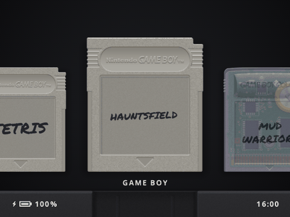

[**Download slot-x-gravy-v1.0**](https://github.com/roygravy/slot/releases) · [Install](#install) · [What's new](#whats-new) · [Controls](#controls)

---

## What is slot. x GRAVY?

slot. x GRAVY is a custom build of [slot.](https://github.com/BrandonKowalski/slot), Brandon Kowalski's bespoke Game Boy, Game Boy Color and Game Boy Advance frontend, tuned for the **Anbernic RG35XX Plus** and its 640×480 screen.

New to slot.? Everything you need to know first (what it is, how it works, the full guide) is on **[slot-cfw.fyi](https://slot-cfw.fyi)**. slot. x GRAVY only changes the look and a few menus; the rest works the same.

Where slot. is modelled on the GBA SP, slot. x GRAVY leans into the handheld it runs on: the RG35XX Plus is a love letter to the original Game Boy, so Game Boy carts go into a Game Boy slot, the plastic looks like plastic, and every menu is written for people who just want to play.

It plays GB, GBC and GBA games only (unzipped ROMs), on mGBA, gpSP and Gambatte.

### Ridiculously fast

Power on and your shelf is there in **3 to 5 seconds**. Push a cart in and you're playing, right where your last save state left off.

### A screen that looks like the real thing

Out of the box, every game looks the way it did on the original hardware: a fine LCD grid between the pixels, the softer colors of the old screens, and Game Boy games in the green of the original DMG. Pale pixels let the screen behind them show through, and moving pixels leave a faint trail, like an old LCD.

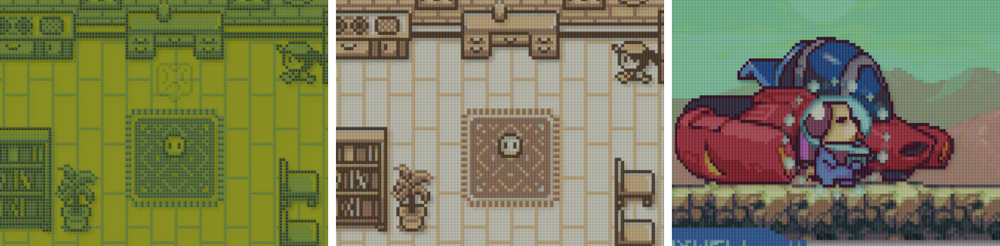

Prefer it sharp and bright? **Screen Look** in the Screen menu switches everything at once between *Authentic* (the default) and *Clean*. Or pick and choose:

| Setting | Consoles | What it does |
|---|---|---|
| LCD Grid | GB, GBC, GBA | Thin lines between the pixels, like the real screen |
| Original Colors | GB, GBC, GBA | Softer colors, the way the original screen showed them |
| Color Palettes | GB | Tint Game Boy games: 48 palettes, from DMG Green and Game Boy Pocket to the Game Boy Color and Super Game Boy sets. SELECT + L2 / R2 flips through them in a game |
| See-Through Pixels | All | Pale pixels let the screen behind them show through |
| Motion Blur | All | Moving pixels fade out slowly, like an old LCD |

In a game, **SELECT + B / A** turns the LCD grid on or off and **SELECT + Y** the original colors.

---

## What's new

### Two themes, two slots

A **Dark** and a **Light** housing, each with its own clean wallpaper. Mix and match as you like: either wallpaper goes with either theme, or drop your own PNGs in the `Wallpapers` folder and pick one by name. Game Boy and GBA games each get their own cartridge slot.

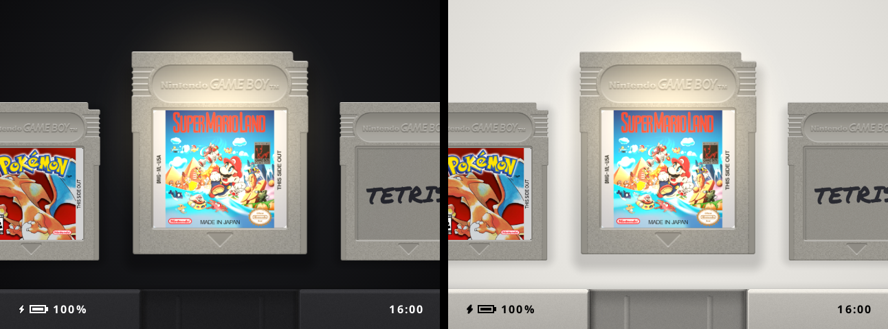

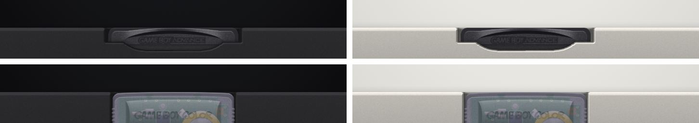

### Favorites that stand out

Press **Y** on any cart to make it a favorite. Favorites stand a little taller on their shelf under a soft, warm spotlight, and get a shelf of their own where the light stays put in the middle as you scroll through it. Prefer something quieter? Pick **Star** instead.

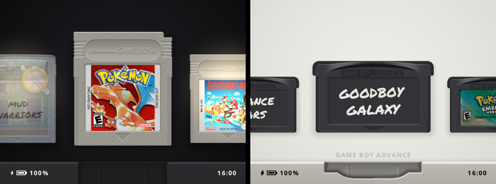

### Carts without label art

No scan for a game? It still gets a proper cartridge: bare plastic with the title written on by hand in marker, dark on Game Boy carts, white on the GBA's dark shell.

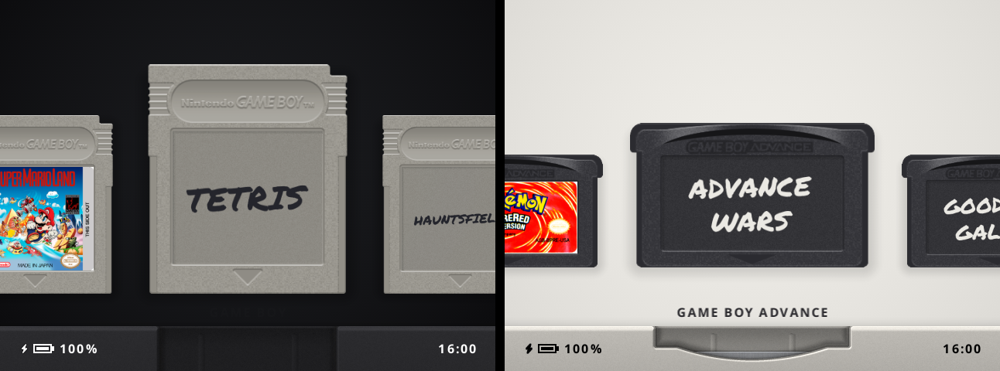

### Menus anyone can use

Every settings page lists its options on the left with the value on the right, flat pill switches for anything that's on or off, and a plain-English line at the bottom saying what the selected option does. The light theme gets light menus.

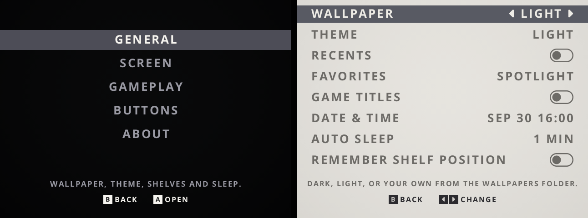
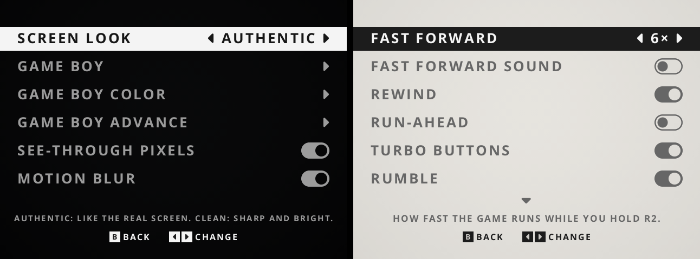

### Every button, explained — and a proper power menu

A **Buttons** page in the menu lists every shortcut, everywhere. Hold **POWER** for **Sleep**, **Restart** or **Power Off**.

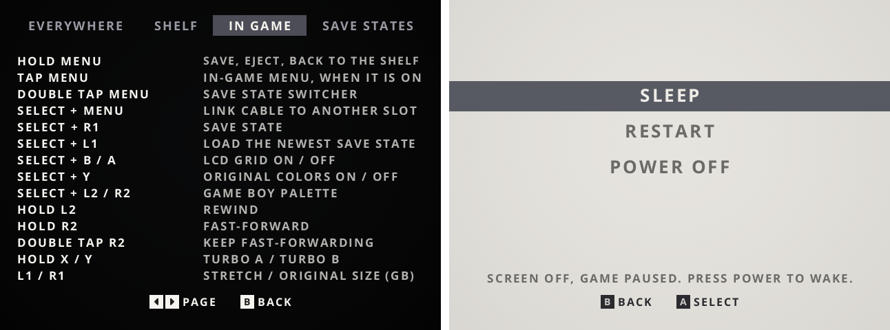

### Play

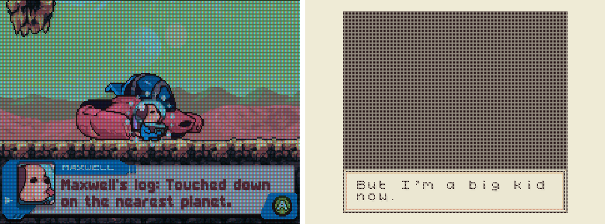
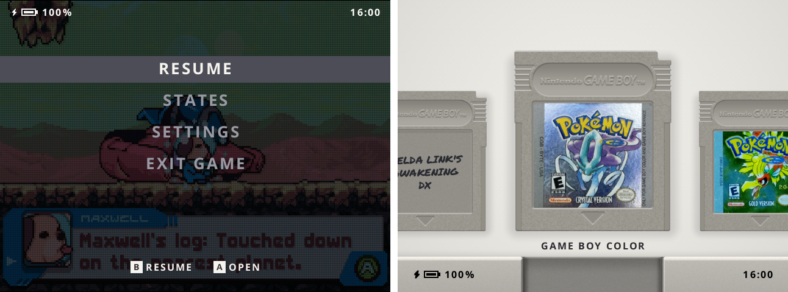

### And more

- Carts sit a little smaller on the carousel, with soft drop shadows that lift them off the wallpaper
- Game titles under the shelf at the same size as the shelf names
- A lighter GBA LCD grid
- Games start on your Favorites shelf when you have favorites, otherwise on Game Boy
- Sleep after 1 minute by default, power off after 5 minutes asleep

---

## Install

1. Download **slot-x-gravy-v1.0.zip** from the [releases](https://github.com/roygravy/slot/releases).
2. Unzip it and copy the **contents** of the `slot-x-gravy-v1.0` folder onto the second SD card of your RG35XX Plus.
3. Put your games in `Games/GB`, `Games/GBC` and `Games/GBA`, and optional label art (PNG, named like the ROM) in the matching `Labels` folders.
4. Put the BIOS files (`gb_bios.bin`, `gbc_bios.bin`, `gba_bios.bin`) in `BIOS/` if you have them.

ROMs must be unzipped; `.zip` and `.7z` are not read.

---

## Controls

The full list is on the **Buttons** page in the menu. The essentials:

| On the shelf | |
|---|---|
| Left / Right | Move along the shelf |
| L1 / R1 | Switch shelf |
| Tap A / Hold A | Play from your last save / start fresh |
| Y | Favorite |
| MENU | Settings |

| In a game | |
|---|---|
| Hold MENU | Save, eject and back to the shelf |
| Double tap MENU | Save state switcher |
| Hold L2 / Hold R2 | Rewind / fast-forward |
| SELECT + Up / Down | Brightness |
| SELECT + MENU | Link cable to another slot. device |

---

## Building

slot. x GRAVY builds the same way slot. does; see [the slot. README](SLOT_README.md) and `taskfile.yml`. The cartridge slots are drawn by `tools/slot_art.py`. Screenshots in this page were rendered headless with `cargo run --release -p slot --no-default-features --example shoot`.

---

## Credits

- **[slot.](https://github.com/BrandonKowalski/slot)** by Brandon Kowalski, the frontend slot. x GRAVY is built on, with artwork by Markus and contributions from its community
- **mGBA**, **gpSP** and **Gambatte**, the emulator cores (their licenses and sources ship in `System/licenses`)
- **Permanent Marker** by Font Diner (Apache 2.0) for the handwritten titles
- **Liberation Sans** by Red Hat (SIL OFL 1.1), subset as "slot Serial", for the serial sticker on the About page
- **Goodboy Galaxy** (demo), **Hauntsfield** and **Mud Warriors**, the free games in the screenshots

Like slot., slot. x GRAVY was put together with help from Claude.

Licensed under the same terms as slot.; see [LICENSE](LICENSE).

---

## AI Disclosure

None of this is meant to be taken seriously. Every line of code, every pixel of the slot art and every word on this page was generated by Claude; I mostly pointed at things and said "a bit rounder" a lot.

I made slot. x GRAVY purely for myself, so that my device feels like *my* device. If you enjoy it too, that's a lovely bonus.

All the praise and credit goes to [Brandon](https://github.com/BrandonKowalski/slot) and the very special base he built. slot. is the whole meal; I'm just pouring a little of my own gravy over it.
